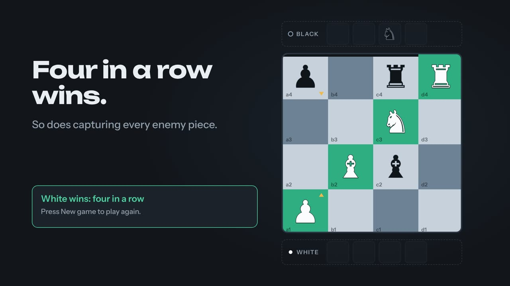

# Chess Tic Tac Toe

A 4x4 board game. Both sides have a pawn, rook, knight and bishop. Spawn pieces on your back row, then move and capture like chess to line up four in a row, or wipe out every enemy piece on the board.

<a href="https://soyamdarshan.github.io/chess-tic-tac-toe/#demo"></a>

**[Watch the 22-second demo](https://soyamdarshan.github.io/chess-tic-tac-toe/#demo)** · [Play it](https://soyamdarshan.github.io/chess-tic-tac-toe/play/) · [Read the docs](https://soyamdarshan.github.io/chess-tic-tac-toe/)

Play it by opening `dist/index.html` in a browser. It is a single self-contained page: against the computer (five levels) or two players on one screen, with Undo, Hint and a warning when your opponent is about to win.

## Documentation

The site at https://soyamdarshan.github.io/chess-tic-tac-toe/ has the demo video and a link to play in the browser. Full rules are in [docs/RULES.md](docs/RULES.md).

## Develop

Needs Node 22 or newer. There are no runtime dependencies.

| Command | What it does |
| --- | --- |
| `npm run build` | Inlines `src/` into `dist/index.html` |
| `npm test` | Rule and computer-opponent tests |
| `npm run e2e` | Builds, then plays the page in a headless browser (needs Playwright) |
| `npm run balance` | Computer-vs-computer games to check balance and tune levels |

## Layout

```
src/engine.js      rules, move generation and the computer opponent (no DOM)
src/ui.js          board, trays, status, undo, hint
src/styles.css     styles
src/index.html     page shell with markers for the three files above
build.js           builds dist/index.html
test/              engine tests and a browser smoke test
tools/balance.js   balance and difficulty simulation
dist/index.html    the built game
promo/             launch video and the scripts that regenerate it
```

After changing anything in `src/`, run `npm run build` so `dist/index.html` stays current.
